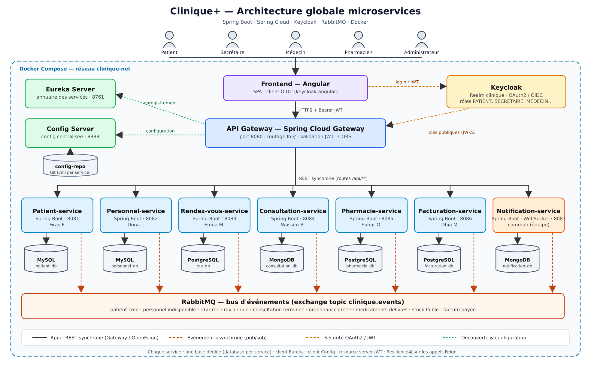

# Clinique+ — Gestion de clinique en microservices

Projet AWD (ESPRIT, 2026-2027). Application de gestion d'une clinique : dossiers patients, personnel médical, rendez-vous, consultations et ordonnances, pharmacie, facturation et notifications.

> Renommez le dépôt selon la convention `nomProjet-classe-groupe` (ex. `cliniquePlus-4xxx-gX`).

## Équipe et microservices

| Microservice | Port | Base de données | Responsable | Rôle |
|---|---|---|---|---|
| `patient-service` | 8081 | MySQL (`patient_db`) | Firas Ferchichi | Fiche administrative du patient, couverture sociale (CNAM / assurance), antécédents médicaux. |
| `personnel-service` | 8082 | MySQL (`personnel_db`) | Doua Jlassi | Médecins, infirmiers, secrétaires et pharmaciens ; spécialités, horaires de travail et absences. |
| `rendezvous-service` | 8083 | PostgreSQL (`rdv_db`) | Emna Mejri | Prise, confirmation, annulation et suivi des rendez-vous ; calcul des créneaux libres. |
| `consultation-service` | 8084 | MongoDB (`consultation_db`) | Wassim Becharguia | Dossier médical : consultations, constantes, diagnostics, examens demandés et ordonnances. |
| `pharmacie-service` | 8085 | PostgreSQL (`pharmacie_db`) | Sahar Ouslati | Catalogue de médicaments, stock par lots (péremption), délivrance des ordonnances. |
| `facturation-service` | 8086 | PostgreSQL (`facturation_db`) | Dhia Mouha | Factures (consultation, médicaments, examens), part mutuelle / part patient, paiements, tarifs. |
| `notification-service` | 8087 | MongoDB (`notification_db`) | Toute l'équipe (présenté par Firas Ferchichi) | Consomme les événements de tous les services ; envoie emails / SMS, notifications temps réel (WebSocket STOMP) et rappels de RDV J-1 planifiés. |

Infrastructure : `eureka-server` (8761), `config-server` (8888), `api-gateway` (8080), Keycloak (8180), RabbitMQ (5672 / console 15672), Mailpit (8025).

## Architecture



- **Frontend** Angular → **API Gateway** (Spring Cloud Gateway) : point d'entrée unique, routage `lb://` via Eureka, validation du JWT.
- **Keycloak** : authentification OAuth2/OIDC, realm `clinique`, rôles `PATIENT`, `SECRETAIRE`, `MEDECIN`, `PHARMACIEN`, `ADMINISTRATEUR`.
- **Eureka** : découverte des services. **Config Server** : configuration centralisée (`config-server/src/main/resources/config-repo`).
- **Une base par microservice**, aucune base partagée.
- **Synchrone** : OpenFeign + Resilience4j (circuit breaker + fallback). **Asynchrone** : RabbitMQ, exchange topic `clinique.events`.

Détail des interactions : [`Documentation/Diagrams/interactions-microservices.png`](Documentation/Diagrams/interactions-microservices.png).

## Stack

Java 21 · Spring Boot 4.1 · Spring Cloud 2025.1 · Spring Data JPA / MongoDB · OpenFeign · Resilience4j · Spring AMQP · Spring Security OAuth2 Resource Server · SpringDoc OpenAPI · Angular 22 · Keycloak 26 · RabbitMQ 4 · MySQL 8 · PostgreSQL 17 · MongoDB 8 · Docker Compose.

## Structure du dépôt

```
.
├── Backend/
│   ├── eureka-server/  config-server/  api-gateway/
│   ├── patient-service/  personnel-service/  rendezvous-service/
│   ├── consultation-service/  pharmacie-service/  facturation-service/
│   └── notification-service/        # microservice commun
├── Frontend/clinique-frontend/      # Angular
├── Documentation/
│   ├── Presentation/                # support de la séance 4
│   ├── Diagrams/                    # architecture, interactions, cas d'utilisation, classes
│   └── dossier-technique (.docx)
├── keycloak/realm-clinique.json     # realm importé au démarrage
├── docker-compose.yml
└── README.md
```

Chaque microservice suit le même découpage de paquets : `domain` (entités / documents), `repository`, `client` (OpenFeign + fallbacks), `event` (records d'événements), `messaging` (RabbitMQ), `config` (sécurité).

## Lancement

### En local (développement)
1. `cd Backend/eureka-server && ./mvnw spring-boot:run`
2. `cd Backend/config-server && ./mvnw spring-boot:run`
3. Lancer le(s) microservice(s) voulu(s) : `./mvnw spring-boot:run`. Sans base disponible, les services JPA démarrent sur H2 en mémoire ; la sécurité est désactivée en local (`SECURITY_ENABLED=false`).
4. `cd Frontend/clinique-frontend && npm install && npm start` → http://localhost:4200

### Avec Docker
```bash
cd Backend && for d in */; do (cd "$d" && ./mvnw -q -DskipTests package); done && cd ..
docker compose up -d --build
```
- Eureka : http://localhost:8761 — Gateway : http://localhost:8080 — Keycloak : http://localhost:8180 (admin/admin)
- RabbitMQ : http://localhost:15672 (guest/guest) — Mailpit : http://localhost:8025
- Comptes de démonstration (mot de passe `demo123`) : `patient`, `secretaire`, `medecin`, `pharmacien`, `admin`.

Swagger de chaque service : `http://localhost:<port>/swagger-ui.html`.

## Organisation et gestion de projet

- Branches : `main` (stable) ← `develop` ← `feature/<service>-<sujet>` ; merge par pull request relue par un autre membre.
- Commits : `feat(rendezvous): ...`, `fix(patient): ...`, `docs: ...`.
- Suivi des tâches : GitHub Projects (tableau Kanban : Backlog / En cours / En revue / Terminé), une issue par tâche, assignée à son responsable.

## Mise en place du dépôt (validation 1)

Pour que chaque membre ait des commits personnels (critère I3), pousser en plusieurs commits :

1. Un membre crée le dépôt public, ajoute l'enseignant et les 5 autres membres comme collaborateurs, puis pousse l'infrastructure : `README.md`, `.gitignore`, `docker-compose.yml`, `keycloak/`, `Backend/eureka-server`, `Backend/config-server`, `Backend/api-gateway`, `Documentation/`.
2. Chaque responsable pousse ensuite **lui-même** son projet depuis son poste : `git add Backend/<son-service> && git commit -m "feat(<service>): initialisation du microservice" && git push`.
3. Le frontend et `notification-service` sont poussés par deux autres membres.
4. Vérifier que chaque projet démarre : `cd Backend/<service> && ./mvnw spring-boot:run`.
